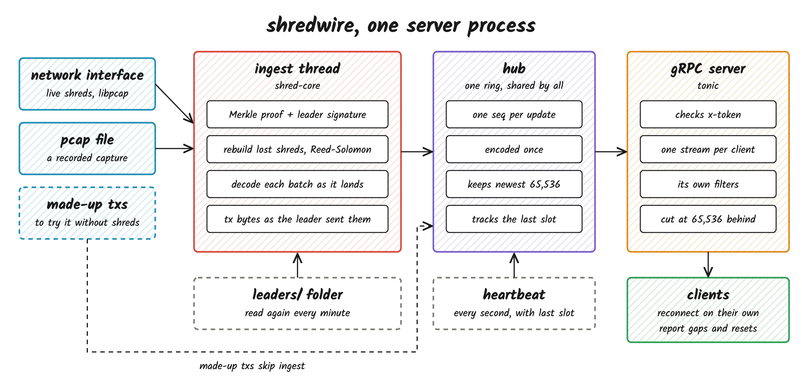

# shredwire

A gRPC feed of Solana transactions, read straight from shreds.

A leader sends its block out as shreds, long before the block is complete or visible over RPC. shredwire reads those shreds on the machine they reach, checks every one with [shred-core](https://github.com/vyralabshq/shred-core), and streams each transaction to clients the moment its batch decodes. Clients subscribe with an API key and filters, and get a numbered stream that tells them when something was missed.



1. **Ingest** reads shreds from a network interface or a pcap file. Every shred's Merkle proof and its slot leader's signature are checked, so forged or changed shreds never reach a client. Lost shreds are rebuilt with Reed-Solomon.
2. **Each transaction** is sent as soon as its batch decodes, as the exact bytes the leader sent, with its slot and arrival times.
3. **The hub** gives every update a sequence number and encodes it once for all clients.
4. **Each client** gets only what matches its filters. A client that falls 65,536 updates behind is cut, so one slow client never slows the rest.

## Quick start

No shreds needed. The server makes up transactions so you can see the stream.

The server needs Rust, a C compiler and libpcap. On Debian or Ubuntu that is `sudo apt install build-essential libpcap-dev`. macOS already has both once Xcode's command line tools are installed.

```sh
git clone https://github.com/jkrishnad/shred-wire
cd shred-wire
cargo build --release
```

In one terminal start the server, and in another the client.

```sh
target/release/server --token demo
target/release/client --token demo
```

The client prints every transaction and a heartbeat every second. Made-up transactions are empty, only real shreds carry real ones.

## Real shreds

The server has to run on a machine that shreds reach, like your own validator or RPC node, or a box a shred feed sends to. It picks shreds out of the interface's UDP traffic by their size, whatever the port.

**1. A leader schedule.** Signatures can't be checked without knowing each slot's leader, so the server won't start without one. Save one file per epoch with the [Solana CLI](https://docs.anza.xyz/cli/install).

```sh
mkdir leaders
EPOCH=$(solana epoch -um)
solana leader-schedule -um --epoch $EPOCH > leaders/$EPOCH.txt
```

Use `-ut` for testnet. The folder is read again every minute, so drop the next epoch's file in before it starts and there's no restart.

**2. Permission to capture.** Either run as root, or give the binary the two capabilities once.

```sh
sudo setcap cap_net_raw,cap_net_admin=eip target/release/server
```

**3. Run it** on the interface the shreds arrive on.

```sh
target/release/server --token my-key --interface eth0 --leaders leaders/
```

To replay a capture instead, use `--pcap shreds.pcap` in place of `--interface`.

`--token` can be given more than once for more API keys. The server listens on `127.0.0.1:50051`, or wherever `--listen` says. It has no TLS, so reach it from other machines through an SSH tunnel or a TLS proxy.

```sh
ssh -N -L 50051:127.0.0.1:50051 user@your-server
```

## Your own client

**Rust.** The `shredwire-client` crate connects, reconnects on its own, and reports anything missed. It doesn't need libpcap.

```toml
[dependencies]
shredwire-client = { git = "https://github.com/jkrishnad/shred-wire" }
tokio = { version = "1", features = ["macros", "rt-multi-thread", "sync"] }
```

```rust
use shredwire_client::proto::TxFilter;
use shredwire_client::proto::subscribe_response::Kind;
use shredwire_client::{Config, Event};
use tokio::sync::mpsc;

#[tokio::main]
async fn main() {
    let config = Config {
        url: "http://127.0.0.1:50051".into(),
        token: "my-key".into(),
        filters: [("all".into(), TxFilter::default())].into(),
    };
    let (events, mut received) = mpsc::unbounded_channel();
    tokio::spawn(shredwire_client::run(config, events));

    while let Some(event) = received.recv().await {
        match event {
            Event::Update(update) => {
                if let Some(Kind::Tx(tx)) = update.kind {
                    // tx.transaction holds the transaction exactly as the leader encoded it
                    println!("{} slot {} {} bytes", update.seq, tx.slot, tx.transaction.len());
                }
            }
            Event::Gap { from, to } => println!("missed {from}..={to} while disconnected"),
            Event::Reset { .. } => println!("server restarted"),
            Event::Stopped { reason } => {
                // a wrong key or a bad filter, retrying won't help
                eprintln!("stopped, {reason}");
                break;
            }
            _ => {}
        }
    }
}
```

**Any other language.** Generate a client from [`bin/proto/feed.proto`](bin/proto/feed.proto), call `Subscribe`, and send the API key in the `x-token` header.

## What clients get

Every update has a `seq` that grows by one for the life of the server. After a reconnect, the missing seqs are exactly what was missed. A server restart changes the boot epoch in the `x-shredwire-epoch` header, so it isn't mistaken for a gap.

Filters are named, and a transaction is sent when at least one matches.

| Filter             | Matches when the transaction  |
| ------------------ | ----------------------------- |
| `account_include`  | touches any of these accounts |
| `account_exclude`  | touches none of them          |
| `account_required` | touches all of them           |

Accounts loaded from lookup tables can't be known from shreds, so filters don't match on them.

A wrong API key or a bad filter stops the Rust client. Anything else, it retries.

## Measured

Replaying real testnet captures locally.

- Ingest handles about 134,000 transactions a second on one core, every shred checked.
- 50 clients at 10 times live speed, none cut, server under one core.

## Limits

- No TLS.
- No slot events. The heartbeat's `last_slot` is the only slot signal.

## Tests

```sh
cargo test
```

One more test runs a real capture through ingest. Captures aren't in the repo, so point it at your own.

```sh
SHREDWIRE_PCAP=/path/to/shreds.pcap SHREDWIRE_LEADERS=/path/to/leaders cargo test -p shredwire-server --test ingest
```
